## La app funcionando en el celular

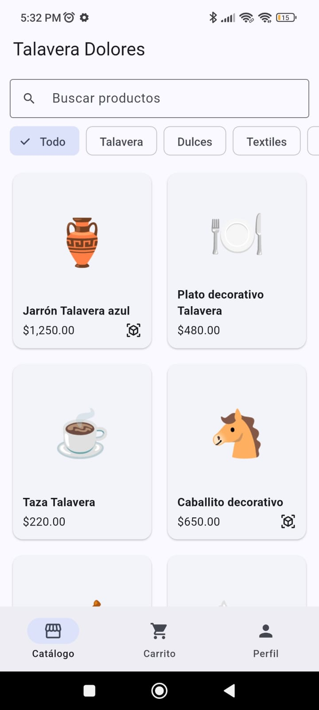

---

## Evidencias TDD (rojo → verde)

**Alumna:** Yaneli Sánchez Cárdenas · **Grupo:** GTID244

Cada ronda muestra primero la prueba en **rojo** (falla porque el código aún no existe) y después en **verde** (pasa con la implementación). En cada captura se ve la prueba que se ejecuta, el resultado en la terminal, mi nombre y mi foto de perfil.

### Ronda 1

**🔴 Rojo — la prueba falla**

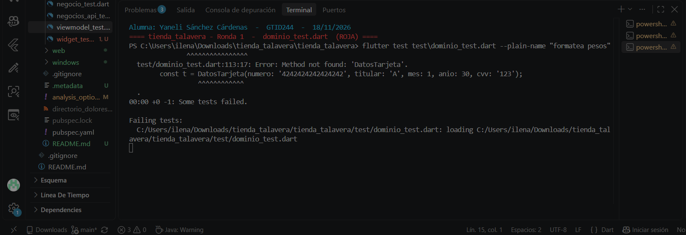

**🟢 Verde — la prueba pasa**

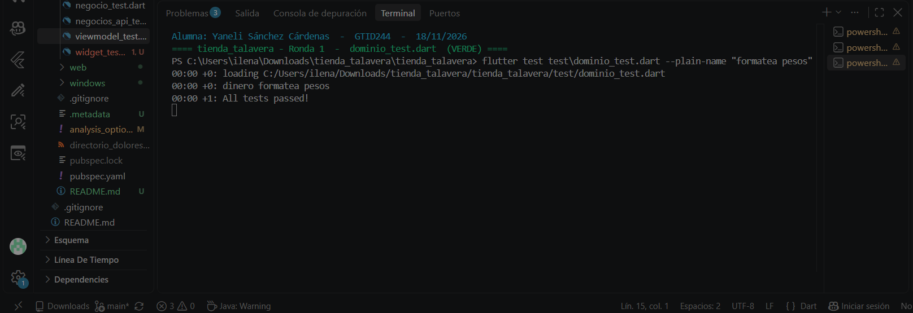

### Ronda 2

**🔴 Rojo — la prueba falla**

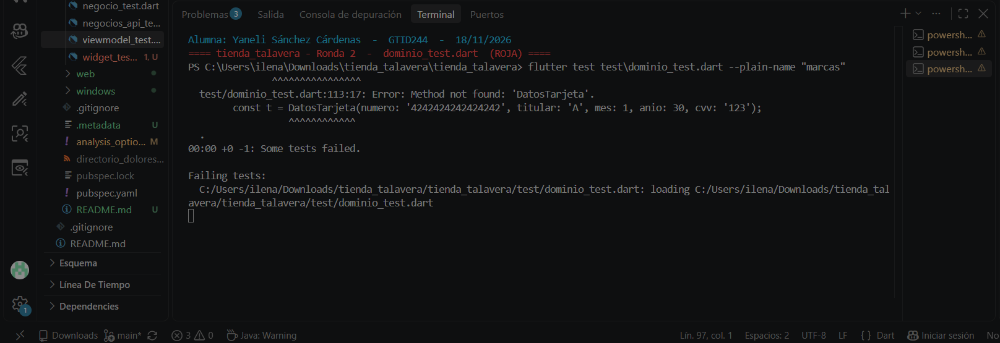

**🟢 Verde — la prueba pasa**

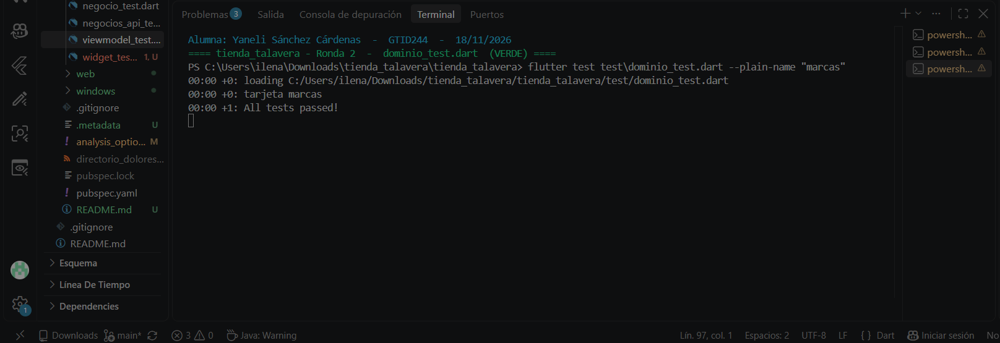

### Ronda 3

**🔴 Rojo — la prueba falla**

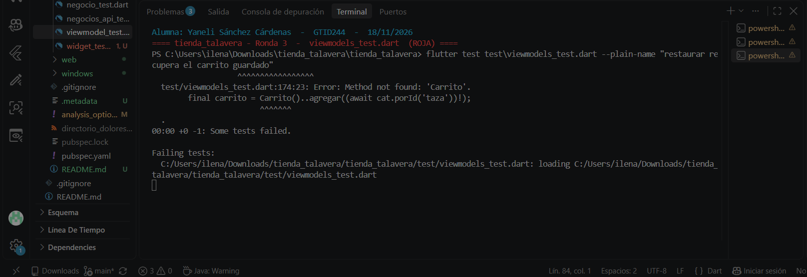

**🟢 Verde — la prueba pasa**

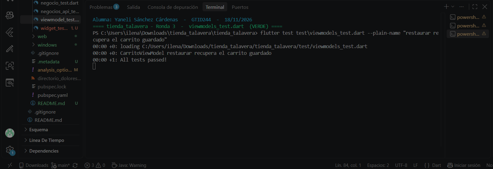

### Ronda 4

**🔴 Rojo — la prueba falla**

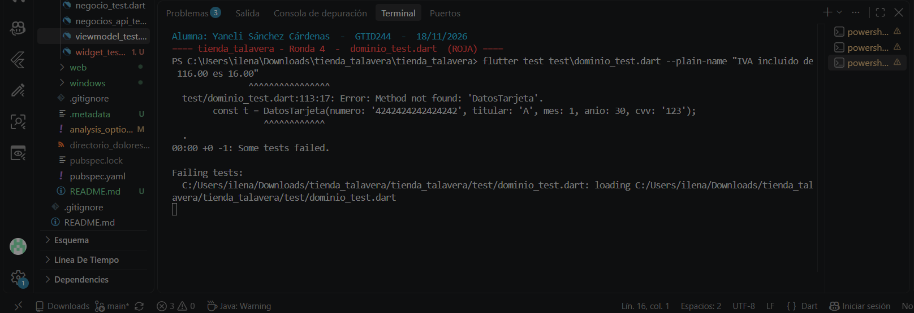

**🟢 Verde — la prueba pasa**

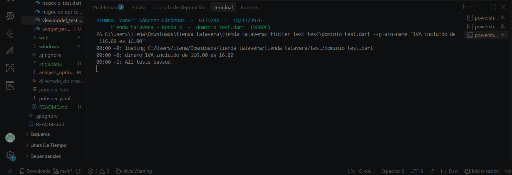

### Ronda 5

**🔴 Rojo — la prueba falla**

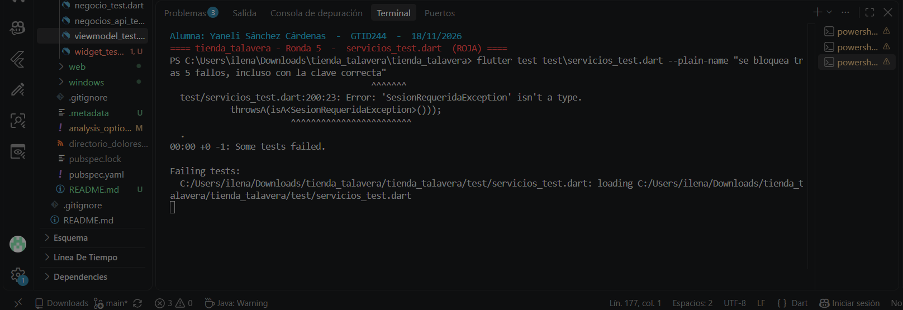

**🟢 Verde — la prueba pasa**

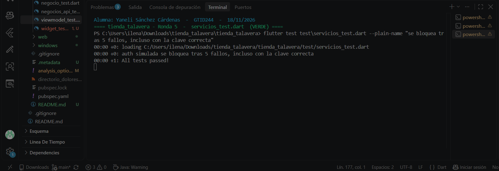

### Ronda 6

**🔴 Rojo — la prueba falla**

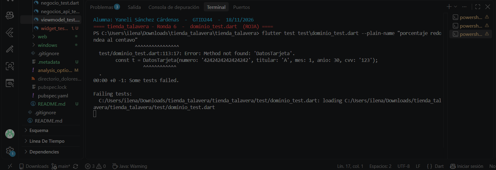

**🟢 Verde — la prueba pasa**

